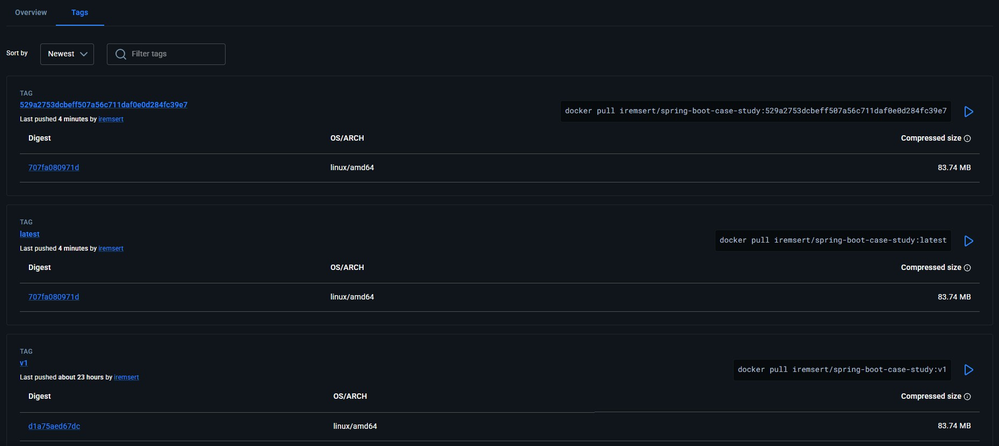
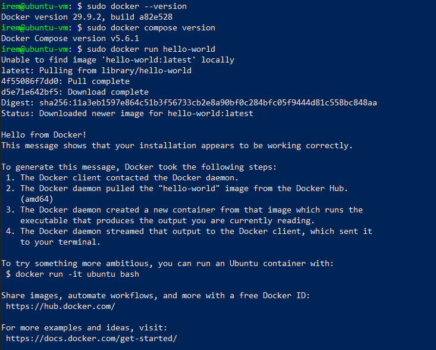
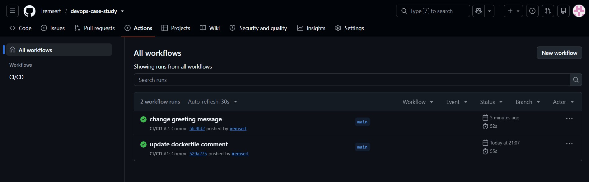
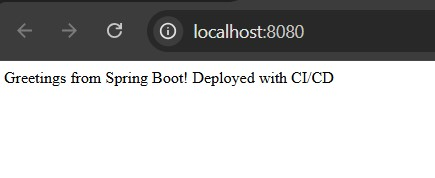
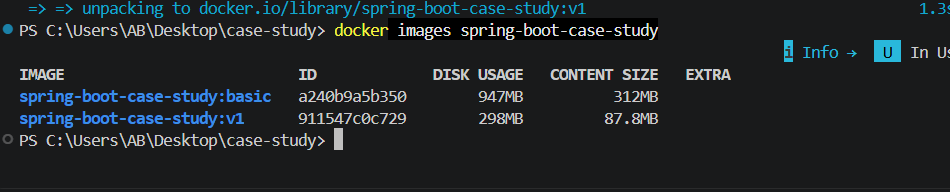

# DevOps Case Study

This repo contains a Spring Boot app (from the Spring "Getting Started" guide, the `complete` directory) that I containerized, optimized, and deployed on an Ubuntu VM. The VM setup is automated with Vagrant.

Docker Hub image: https://hub.docker.com/r/iremsert/spring-boot-case-study

## Architecture Overview

```
Windows host
 ├── WSL2 + Docker Desktop   -> build the image, push to Docker Hub
 └── VirtualBox + Vagrant
       └── Ubuntu 26.04 LTS VM
             └── Docker + Compose
                   └── spring-boot-case-study container (port 8080)
```

The flow is simple: build the image on my machine, push it to Docker Hub, and the VM pulls it from there and runs it with Docker Compose.

## Files

| File | What it does |
|------|--------------|
| `Dockerfile` | Multi-stage build (Maven build, then a small JRE Alpine image, non-root user) |
| `Dockerfile.basic` | The first, simple single-stage version. Kept only for the size comparison |
| `docker-compose.yml` | Runs the app from the Docker Hub image on port 8080, plus Watchtower for automatic updates |
| `.github/workflows/ci-cd.yml` | GitHub Actions pipeline that builds the image and pushes it to Docker Hub |
| `Vagrantfile` | Creates the Ubuntu VM and runs the provisioning |
| `provision.sh` | Installs Docker Engine and the Compose plugin, then starts the app |
| `pom.xml`, `src/`, `mvnw` | The Spring Boot app itself |

## Prerequisites

- Windows 10/11 with WSL2 enabled
- Docker Desktop (WSL2 backend)
- Oracle VirtualBox
- HashiCorp Vagrant
- A Docker Hub account
- Git

## Step-by-step

### Phase 1: Build and push the image

1. Install WSL2 and Docker Desktop (WSL2 backend).
2. Clone the Spring Boot repo and copy the contents of `complete` into the project folder.
3. Build the first version with the simple Dockerfile and check its size:

   ```
   docker build -f Dockerfile.basic -t spring-boot-case-study:basic .
   docker images spring-boot-case-study
   ```

4. Build the optimized version with the multi-stage Dockerfile:

   ```
   docker build -t spring-boot-case-study:v1 .
   ```

5. Test it locally:

   ```
   docker run -d -p 8080:8080 --name case-study-test spring-boot-case-study:v1
   ```

   Open http://localhost:8080, it should show "Greetings from Spring Boot!". Then stop and remove the test container.

6. Log in and push to Docker Hub:

   ```
   docker login
   docker tag spring-boot-case-study:v1 iremsert/spring-boot-case-study:v1
   docker push iremsert/spring-boot-case-study:v1
   ```
   
   

### Phase 2: Manual VM deployment

1. Install VirtualBox and create a new VM with the Ubuntu Server 26.04.1 LTS ISO (2 GB RAM, 2 CPUs, 20 GB disk). I selected "Install OpenSSH server" during the installation.
2. In the VM network settings (NAT) I added two port forwarding rules: host 2222 to guest 22 (SSH), and host 8080 to guest 8080 (the app).
3. Connect with SSH from Windows:

   ```
   ssh <username>@localhost -p 2222
   ```

4. Install Docker Engine and the Compose plugin from Docker's official apt repository (the same commands are in `provision.sh`).
5. Create `docker-compose.yml` and start the app (in this phase the file only had the `app` service with the `v1` tag, Watchtower was added in Phase 5):

   ```
   docker compose up -d
   docker compose ps
   ```

6. Open http://localhost:8080 on the host to check it.



### Phase 3: Vagrant

Everything from Phase 2 is automated. From the project folder:

```
vagrant up
```

Vagrant creates the VM from the `cloud-image/ubuntu-26.04` box, copies `docker-compose.yml` into it, runs `provision.sh` (installs Docker and starts the container). When it finishes, open http://localhost:8080.

Useful commands:

```
vagrant ssh        # go into the VM
vagrant halt       # stop the VM
vagrant destroy    # delete the VM
```

### Phase 5 (bonus): CI/CD with GitHub Actions and Watchtower

**GitHub Actions.** The workflow is in `.github/workflows/ci-cd.yml`. It runs when I push to `main` and one of these changed: `src/`, `pom.xml` or `Dockerfile`. It logs in to Docker Hub, builds the multi-stage image and pushes it with two tags: `latest` and the git commit SHA. The Docker Hub login uses two GitHub Actions secrets: `DOCKERHUB_USERNAME` and `DOCKERHUB_TOKEN` (a Docker Hub access token with read/write permission, not my password).

**Watchtower.** `docker-compose.yml` now has a second service, Watchtower. It has access to the Docker socket and checks Docker Hub every 60 seconds. The `app` service uses the `latest` tag, so when the pipeline pushes a new `latest`, Watchtower pulls it and recreates the app container. I used the `nickfedor/watchtower` image.

**How I tested it.** I changed the text in `HelloController.java` to "Greetings from Spring Boot! Deployed with CI/CD" and pushed. The pipeline ran and passed, and a few minutes later Watchtower logged `Found new image` for the app container. After that, http://localhost:8080 in the browser showed the new text without me touching the VM.





To see what Watchtower did:

```
vagrant ssh
docker logs vagrant-watchtower-1 2>&1 | grep -i "found new"
docker compose ps
```

The `app` container shows a recent creation time, the `watchtower` container is older.

## Image size comparison

| Version | How it is built | Disk usage | Content size |
|---------|-----------------|-----------|--------------|
| `basic` (before) | Single stage, Maven + full JDK + source code in the final image | 947 MB | 312 MB |
| `v1` (after) | Multi-stage, only the JRE and the jar in the final image, runs as non-root user | 298 MB | 87.8 MB |



The image is about 69% smaller. The final image does not need Maven, the JDK or the source code. It only needs the jar and a Java runtime.

## Problems I ran into

- **Docker pull was very slow inside my first VM.** The `docker compose up` kept waiting on the layers. The network itself was fine, so I exported the image on Windows with `docker save`, copied it into the VM with `scp` and loaded it with `docker load`. Later, the Vagrant VM pulled the same image from Docker Hub without any problem.
- **The first Vagrant box was not usable.** `alvistack/ubuntu-26.04` is not published for VirtualBox, and `bento/ubuntu-26.04` did not boot on my machine (SSH timeout). I switched to `cloud-image/ubuntu-26.04`, which supports VirtualBox and worked.
- **Watchtower warnings in the logs.** Watchtower prints `Digest retrieval failed, falling back to full pull` for each container. It is only a warning: it then pulls the image to compare it, and the update still works (`failed=0`).
- **WSL install was blocked on my PC.** The installer asked for a developer license, I fixed it by running PowerShell as administrator and enabling the Windows features with DISM before installing Ubuntu.
